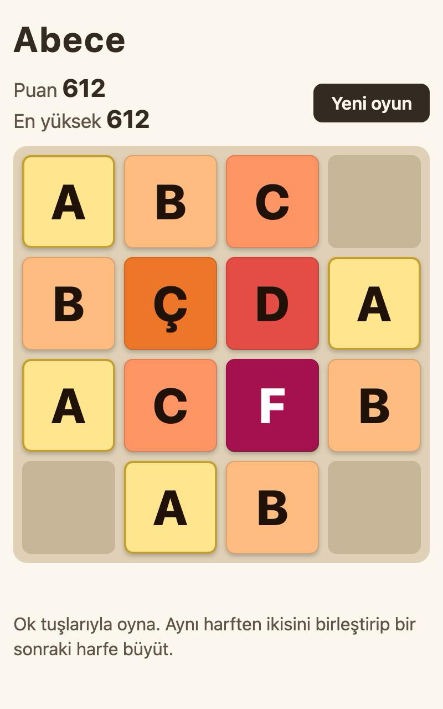

# Abece

Harfleri birleştirip A'dan H'ye büyüttüğün, 4x4 tahtalı bir tarayıcı oyunu.

**[Oyna](https://dogannahmet.github.io/abece/)**



## Nasıl oynanır

- Bilgisayarda ok tuşlarıyla, telefonda parmağınla kaydırarak taşları oynat.
- Aynı harften ikisini birleştirip bir sonraki harfe büyüt: A, B, C, Ç, D, E, F, G, Ğ, H.
- H en büyük harftir. Tahta dolar ve birleşme kalmazsa oyun biter.

## Özellikler

- En yüksek skor tarayıcıda saklanır.
- Kaldığın yerden devam edersin; sayfayı kapatıp açsan da oyun durur.
- Kayma, birleşme ve belirme animasyonları (hareket azaltma tercihine saygı duyar).
- Telefonda çalışır.

## Teknik

Sadece HTML, CSS ve düz JavaScript. Kütüphane ve derleme adımı yok. Oyun kuralları ve ekran ayrı dosyalarda.

```
index.html      sayfa
style.css       stiller ve renk değişkenleri
js/mantik.js    tahta kuralları (DOM'a dokunmaz)
js/ekran.js     tahtayı çizer, animasyonlar
js/oyun.js      tuşlar, kaydırma ve her şeyin bağlantısı
js/depo.js      en yüksek skor ve oyun kaydı
js/girdi.js     kaydırma yönünü bulur
test-*.js       Node testleri
docs/           README görselleri
```

## Yerelde çalıştırma

`index.html` dosyasına çift tıkla. Kurulum gerekmez.

Testler (Node gerekir):

```
node test-mantik.js
node test-depo.js
node test-girdi.js
```

## Sürümler

- **v0.1**: Çalışan oyun, A'dan H'ye harf taşları, açık tema.
- **v0.2**: En yüksek skor, dokunmatik kaydırma, daha iyi ayrışan renkler.
- **v0.3**: Kayma, birleşme ve belirme animasyonları.
- **v0.4**: Kaldığı yerden devam.
